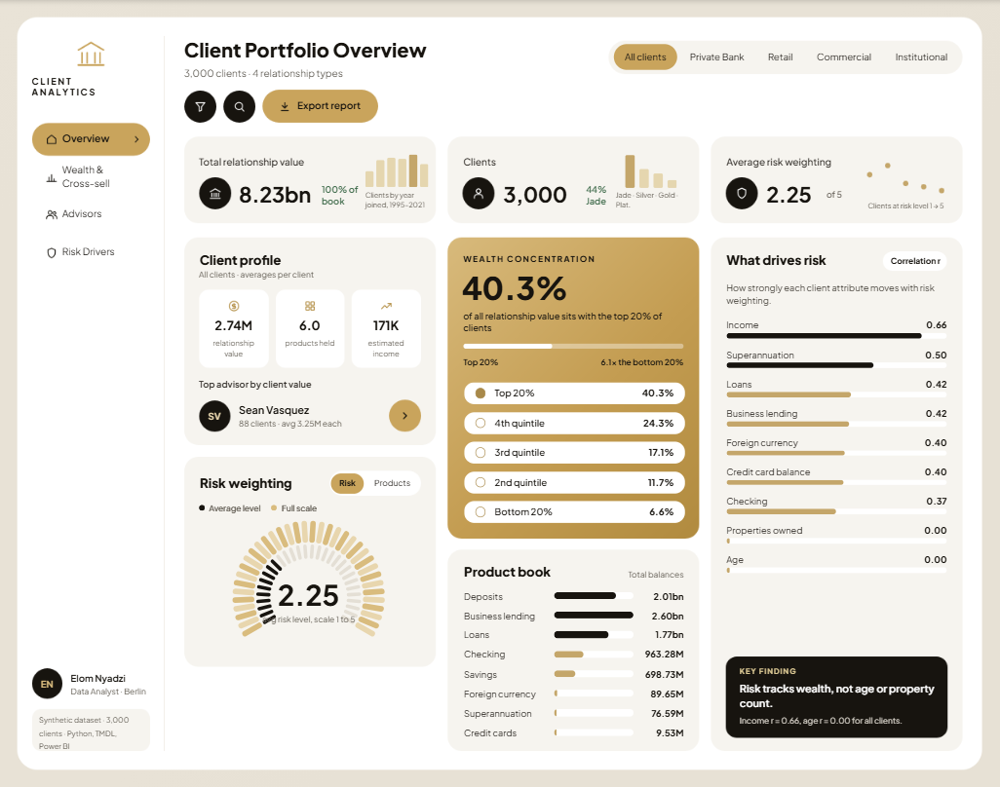
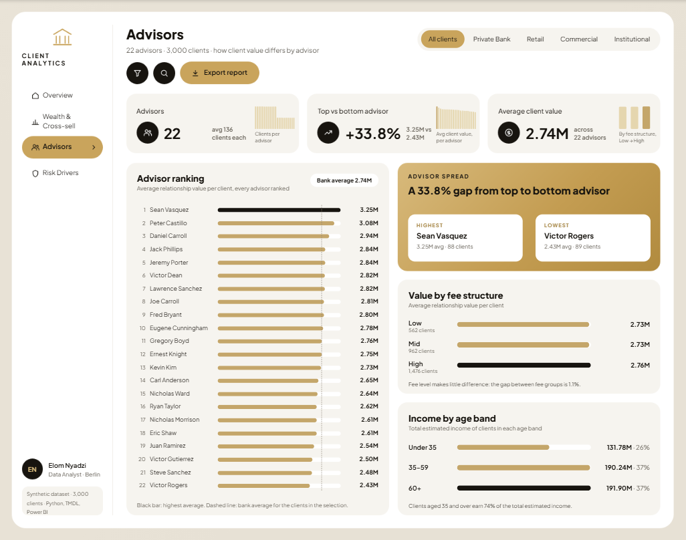
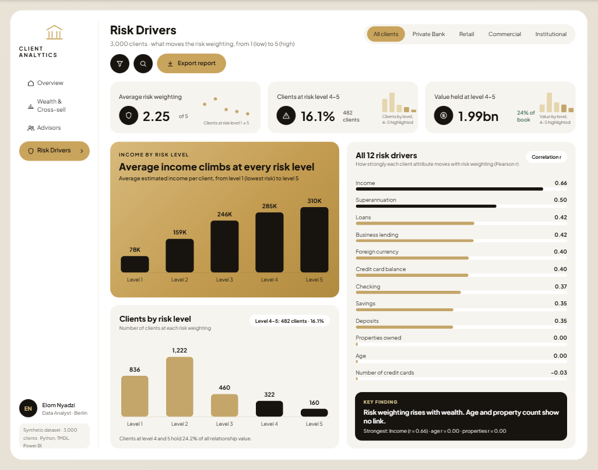

# Banking Client Analysis

A data-cleaning → business-question → interactive-dashboard pipeline built on
a 3,000-row synthetic banking client dataset (client demographics, income,
product holdings, risk, and advisor relationships). Raw data is always
treated as read-only; every cleaning/transform step is a standalone,
re-runnable script; every cleaned output is written to `clean/`; and every
result quoted in analysis is backed by a script that reproduces it.

## Tools used

| Tool | Purpose |
|---|---|
| **Python** | Core language for every script in the project |
| **pandas** | Loading, previewing, cleaning, joining, and aggregating the data |
| **matplotlib** | The 5 static business-question charts (`charts/q*.png`) |
| **openpyxl** (via pandas) | Formatted Excel export for quick data inspection |
| **pbixray** | Extracted the hidden lookup/reference tables directly from the Power BI data model inside `Banking Dashboard.pbix` |
| **PowerShell `Get-FileHash`** | Confirmed two downloaded source CSVs were byte-identical duplicates |
| **`unzip` + manual JSON parsing** | A `.pbix` file is a zip archive. Opening it showed the hidden table names before their values were extracted |
| **Power BI Desktop** | Final interactive dashboard: 4 pages plus a searchable client table, all filtering together |
| **TMDL** (Tabular Model Definition Language) | Plain-text format for the Power BI semantic model (tables, relationships, 44 DAX measures) as version-controlled project files |
| **PBIR** (Power BI enhanced report format) | Report pages and visuals as JSON files, generated by scripts in `powerbi_dashboard/design/` |
| **HTML Content visual** | KPI cards and panels drawn from HTML that DAX measures build, so every number follows the selection |
| **Deneb (Vega-Lite)** | The risk gauge with its Risk / Products switch, and the client-type pills that filter each page |
| **Git** | Version control for this repository |

## Data cleaning steps (`banking_cleaning.py`)

Starting from the raw `banking_data.csv` (3,000 rows, 25 columns, untouched throughout):

1. **Added a surrogate key** (`client_row_id`, 1–3,000), because the source `Client ID` is not reliably unique (see Problems Encountered)
2. **Parsed `Joined Bank`** from ambiguous text (`dd-mm-yyyy`) into a true date type, renamed `joined_bank_date`, stored unambiguously (`yyyy-mm-dd`)
3. **Joined 3 recovered lookup tables** to replace coded IDs (`BRId`, `GenderId`, `IAId`) with readable labels (`banking_relationship`, `gender`, `investment_advisor`); dropped the raw codes
4. **Renamed all columns to `snake_case`**

Result: **3,000 rows in, 3,000 rows out.** No rows were dropped at any step. Output: `clean/banking_data_clean.csv` (26 columns).

## Problems encountered

| Problem | How it was resolved |
|---|---|
| 60 rows shared a `Client ID` with another row | Investigated individually: each pair has a different name, age, join date, and occupation. These are distinct real clients with colliding IDs, not duplicates. Kept all rows; added a surrogate key instead. |
| 39 rows had `age = 17`, outside an assumed 18–100 "plausible" range | These are legitimate values (e.g. youth/custodial accounts), not errors. The 18+ assumption was too strict. Kept as-is. |
| `BRId`, `GenderId`, `IAId` were coded columns with **no legend anywhere in the source file** | The dataset came bundled with a Power BI template (`Banking Dashboard.pbix`). Unzipped it, inspected the report layout to find the hidden table names (`Gender`, `Banking Relationship`, `Investment Advisor`), then used `pbixray` to read the compressed data model directly and extract the real lookup values. |
| Raw dates were in ambiguous `dd-mm-yyyy` text format | Parsed explicitly with a fixed format string, converted to unambiguous ISO dates. |
| `.pbip` Power BI project wouldn't open: the dialog just closed with no error | Power BI Desktop requires two **preview features** enabled ("Power BI Project (.pbip) save option" and "Store semantic model using TMDL format") plus an app restart before it can parse this project format at all. |
| Two of the five original business-question charts (product cross-sell gap by loyalty tier; relationship-type × fee-structure value) came back **flat, with no meaningful pattern** | Reported honestly rather than oversold. A flat result still rules out a hypothesis and is a legitimate finding, not a failure. |

## Data quality report

Full report, structured around the standard data-quality dimensions
(Completeness, Uniqueness, Validity, Consistency, Accuracy):
**[`BANKING_DATA_QUALITY_REPORT.md`](BANKING_DATA_QUALITY_REPORT.md)**

Summary: 100% complete (0 missing values), 0 exact duplicate rows, 0 invalid
dates, 100% ID-pattern match, 0 whitespace/casing issues post-cleaning.

## Business questions & key findings

| # | Question | Chart | Finding |
|---|---|---|---|
| 1 | How concentrated is client value among top clients? | `charts/q1_wealth_concentration.png` | **Strong.** Top 20% of clients hold 40% of total relationship value vs. 7% for the bottom 20%. |
| 2 | What's associated with higher risk weighting? | `charts/q2_risk_drivers.png` | **Strong.** `estimated_income` (r=0.66) and `superannuation_savings` (r=0.50) are the biggest correlates: risk tracks wealth, not age or property count. |
| 3 | Is there a product cross-sell gap by loyalty tier? | `charts/q3_cross_sell_gap.png` | **Weak/flat.** Tiers sit within a ~3% range of each other, so there is no real gap by loyalty tier specifically. |
| 4 | Does relationship type / fee structure track client value? | `charts/q4_relationship_fee_value.png` | **Weak/flat.** All combinations sit in a narrow band with no consistent pattern, which is worth flagging as a pricing question rather than a finding. |
| 5 | How does client value vary by investment advisor? | `charts/q5_advisor_performance.png` | **Moderate.** ~33% spread between the top and bottom advisor's average client value. |

## Interactive Power BI dashboard

**Open `powerbi_dashboard/BankingDashboard.pbix` in Power BI Desktop** to use
the dashboard. `powerbi_dashboard/BankingDashboard.pbip` is the same report as
a project: the model, pages and visuals as version-controlled text files.

How it works:

- **Client-type pills** (All clients, Private Bank, Retail, Commercial, Institutional) filter every number on the page.
- **Menu and header buttons** move between pages. Search, Filter and Export open a searchable client table that can be exported to Excel or CSV. In Power BI Desktop, Ctrl+click a button while editing.
- **Live analysis**: the risk correlations are recalculated for the selected client type, and titles that make a claim check the data first.
- The design uses the free **Plus Jakarta Sans** font; without it, text falls back to Segoe UI.

**Overview**: relationship value, clients and risk at a glance, the client profile, wealth concentration by quintile, the product book, and what drives risk.


**Wealth & Cross-sell (Q1 + Q3)**: where the value sits by quintile, average value and cross-sell depth by loyalty tier.


**Advisors (Q4 + Q5)**: all 22 advisors ranked against the bank average, the gap from top to bottom advisor, value by fee structure, and income by age band.


**Risk Drivers (Q2)**: clients and value at risk levels 4–5, average income by risk level, and the correlation of all 12 client attributes with risk weighting.


## How I built this

The data work and analysis (the questions, cleaning decisions and findings above) are documented step by step in the scripts and the data quality report.

In November 2026 I redesigned the Power BI dashboard with the help of Claude Code, Anthropic's AI coding assistant. I provided the brief and the target design, chose the page layout, and reviewed every page in Power BI before moving on to the next one. Claude wrote the DAX measures, the report files and the build scripts in `powerbi_dashboard/design/`, and checked each number against the data. Commits from that work list Claude as co-author.

## Project files

| Script | What it does |
|---|---|
| `banking_preview.py` | Initial preview (head/shape/dtypes) |
| `banking_quality_report.py` | Full data quality scan of the raw file |
| `banking_investigate_flags.py` | Investigates the duplicate-ID and age-outlier flags |
| `banking_extract_lookups.py` | Recovers the `BRId`/`GenderId`/`IAId` lookup tables from `Banking Dashboard.pbix` → `clean/dim_*.csv` |
| `banking_cleaning.py` | Cleans the raw data → `clean/banking_data_clean.csv` |
| `banking_format_check.py` | Post-cleaning column-format audit |
| `banking_summary_overview.py` | Descriptive overview of the cleaned data |
| `banking_charts.py` | Builds the 5 business-question charts → `charts/` |
| `banking_export_view.py` | Formatted Excel view of the cleaned data |
| `banking_powerbi_export.py` | Adds derived metrics and exports the CSVs Power BI reads |
| `banking_build_dim_date.py` | Optional date dimension for tenure/cohort analysis (not currently linked into the report) |
| `powerbi_dashboard/design/make_backgrounds.py` | Draws the dashboard page backgrounds (shapes and icons, no text) |
| `powerbi_dashboard/design/measures.py` | Writes the DAX measures behind the dashboard cards into the TMDL model |
| `powerbi_dashboard/design/overview.py` | Writes the dashboard pages and visuals as PBIR files |

## Setup

```
pip install -r requirements.txt
```

Run any script from the project root, e.g.:

```
python banking_cleaning.py
```

To open the dashboard, open `powerbi_dashboard/BankingDashboard.pbix` in Power
BI Desktop. The data loads from the `clean/` folder through a Power Query
parameter called **DataFolder**: after cloning, set it to your own path to
`clean\` (Transform data > Edit parameters), then Refresh. Older versions of
Power BI Desktop need the **Power BI Project (.pbip) save option** and **Store
semantic model using TMDL format** preview features to open the `.pbip`.

How the dashboard is built and how to change it: [`NOTES.md`](NOTES.md).

## Project conventions

- Raw data files are never modified.
- Every cleaned/derived output is written to `clean/`.
- Every result reported in analysis is backed by a script that reproduces it.
