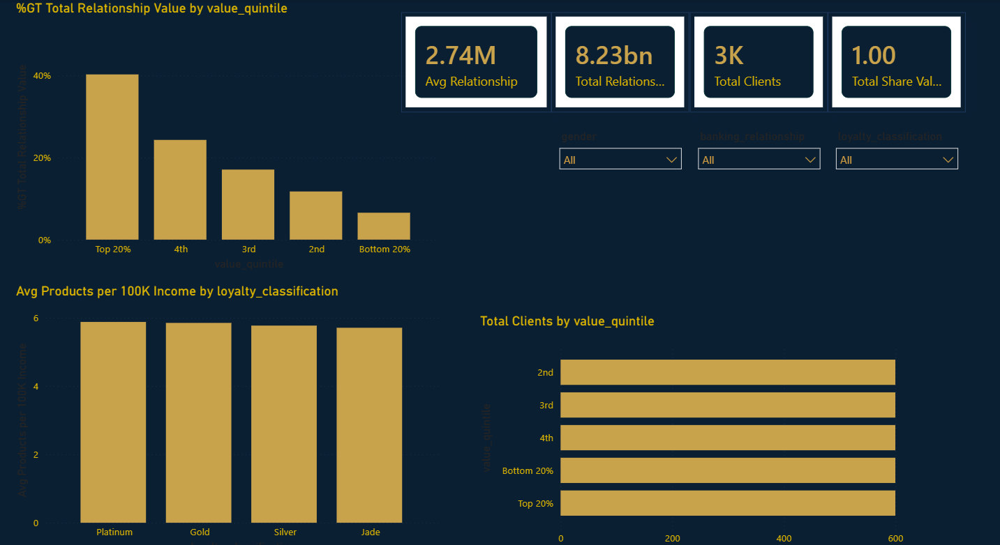
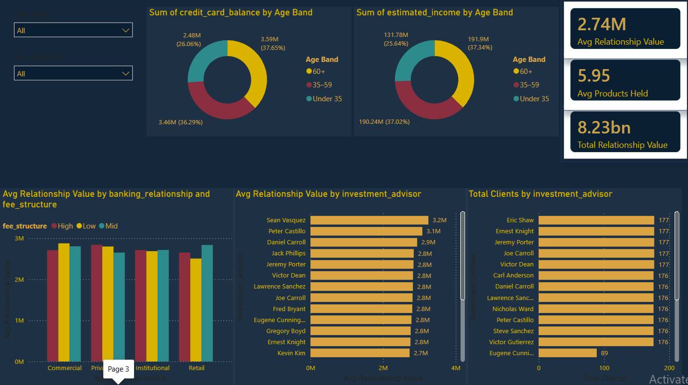

# Banking Client Analysis

A data-cleaning → business-question → interactive-dashboard pipeline built on
a 3,000-row synthetic banking client dataset (client demographics, income,
product holdings, risk, and advisor relationships). Raw data is always
treated as read-only; every cleaning/transform step is a standalone,
re-runnable script; every cleaned output is written to `clean/`; and every
result quoted in analysis is backed by a script that reproduces it.

## Tools used

| Tool | Purpose |
|---|---|
| **Python** | Core language for every script in the project |
| **pandas** | Loading, previewing, cleaning, joining, and aggregating the data |
| **matplotlib** | The 5 static business-question charts (`charts/q*.png`) |
| **openpyxl** (via pandas) | Formatted Excel export for quick data inspection |
| **pbixray** | Extracted the hidden lookup/reference tables directly from the Power BI data model inside `Banking Dashboard.pbix` |
| **PowerShell `Get-FileHash`** | Confirmed two downloaded source CSVs were byte-identical duplicates |
| **`unzip` + manual JSON parsing** | A `.pbix` file is a zip archive — this cracked it open to find the hidden table names before extracting their values |
| **Power BI Desktop** | Final interactive dashboard — cross-filtering slicers and charts across 4 pages |
| **TMDL** (Tabular Model Definition Language) | Plain-text format used to hand-build the Power BI semantic model (tables, relationships, 16 DAX measures) as version-controlled project files |
| **Git** | Version control for this repository |

## Data cleaning steps (`banking_cleaning.py`)

Starting from the raw `banking_data.csv` (3,000 rows, 25 columns, untouched throughout):

1. **Added a surrogate key** (`client_row_id`, 1–3,000) — the source `Client ID` is not reliably unique (see Problems Encountered)
2. **Parsed `Joined Bank`** from ambiguous text (`dd-mm-yyyy`) into a true date type, renamed `joined_bank_date`, stored unambiguously (`yyyy-mm-dd`)
3. **Joined 3 recovered lookup tables** to replace coded IDs (`BRId`, `GenderId`, `IAId`) with readable labels (`banking_relationship`, `gender`, `investment_advisor`); dropped the raw codes
4. **Renamed all columns to `snake_case`**

Result: **3,000 rows in, 3,000 rows out** — no rows were dropped at any step. Output: `clean/banking_data_clean.csv` (26 columns).

## Problems encountered

| Problem | How it was resolved |
|---|---|
| 60 rows shared a `Client ID` with another row | Investigated individually — each pair has a different name, age, join date, and occupation. These are distinct real clients with colliding IDs, not duplicates. Kept all rows; added a surrogate key instead. |
| 39 rows had `age = 17`, outside an assumed 18–100 "plausible" range | These are legitimate values (e.g. youth/custodial accounts), not errors — the 18+ assumption was too strict. Kept as-is. |
| `BRId`, `GenderId`, `IAId` were coded columns with **no legend anywhere in the source file** | The dataset came bundled with a Power BI template (`Banking Dashboard.pbix`). Unzipped it, inspected the report layout to find the hidden table names (`Gender`, `Banking Relationship`, `Investment Advisor`), then used `pbixray` to read the compressed data model directly and extract the real lookup values. |
| Raw dates were in ambiguous `dd-mm-yyyy` text format | Parsed explicitly with a fixed format string, converted to unambiguous ISO dates. |
| `.pbip` Power BI project wouldn't open — dialog just closed with no error | Power BI Desktop requires two **preview features** enabled ("Power BI Project (.pbip) save option" and "Store semantic model using TMDL format") plus an app restart before it can parse this project format at all. |
| Two of the five original business-question charts (product cross-sell gap by loyalty tier; relationship-type × fee-structure value) came back **flat, with no meaningful pattern** | Reported honestly rather than oversold — a flat result still rules out a hypothesis and is a legitimate finding, not a failure. |

## Data quality report

Full report, structured around the standard data-quality dimensions
(Completeness, Uniqueness, Validity, Consistency, Accuracy):
**[`BANKING_DATA_QUALITY_REPORT.md`](BANKING_DATA_QUALITY_REPORT.md)**

Summary: 100% complete (0 missing values), 0 exact duplicate rows, 0 invalid
dates, 100% ID-pattern match, 0 whitespace/casing issues post-cleaning.

## Business questions & key findings

| # | Question | Chart | Finding |
|---|---|---|---|
| 1 | How concentrated is client value among top clients? | `charts/q1_wealth_concentration.png` | **Strong.** Top 20% of clients hold 40% of total relationship value vs. 7% for the bottom 20%. |
| 2 | What's associated with higher risk weighting? | `charts/q2_risk_drivers.png` | **Strong.** `estimated_income` (r=0.67) and `superannuation_savings` (r=0.50) are the biggest correlates — risk tracks wealth, not age or property count. |
| 3 | Is there a product cross-sell gap by loyalty tier? | `charts/q3_cross_sell_gap.png` | **Weak/flat.** Tiers sit within a ~3% range of each other — no real gap by loyalty tier specifically. |
| 4 | Does relationship type / fee structure track client value? | `charts/q4_relationship_fee_value.png` | **Weak/flat.** All combinations sit in a narrow band with no consistent pattern — worth flagging as a pricing question rather than a finding. |
| 5 | How does client value vary by investment advisor? | `charts/q5_advisor_performance.png` | **Moderate.** ~33% spread between the top and bottom advisor's average client value. |

## Interactive Power BI dashboard

Project: `powerbi_dashboard/BankingDashboard.pbip` — semantic model, relationships,
and 16 DAX measures are pre-built as version-controlled TMDL files; the report
visuals were then hand-built in Power BI Desktop across 4 pages, all
cross-filtering: clicking any chart or slicer updates every other visual on
that page automatically.

**Overview** — relationship-type breakdown and 12 KPI cards covering every product line at a glance.


**Wealth & Cross-Sell (Q1 + Q3)** — value concentration by quintile and product penetration by loyalty tier.


**Relationship & Advisor Value (Q4 + Q5)** — value by relationship type × fee tier, and advisor-level book comparison.


**Risk Drivers (Q2)** — correlation of every numeric attribute with risk weighting, plus supporting cuts by relationship type, age band, and gender.


## Project files

| Script | What it does |
|---|---|
| `banking_preview.py` | Initial preview (head/shape/dtypes) |
| `banking_quality_report.py` | Full data quality scan of the raw file |
| `banking_investigate_flags.py` | Investigates the duplicate-ID and age-outlier flags |
| `banking_extract_lookups.py` | Recovers the `BRId`/`GenderId`/`IAId` lookup tables from `Banking Dashboard.pbix` → `clean/dim_*.csv` |
| `banking_cleaning.py` | Cleans the raw data → `clean/banking_data_clean.csv` |
| `banking_format_check.py` | Post-cleaning column-format audit |
| `banking_summary_overview.py` | Descriptive overview of the cleaned data |
| `banking_charts.py` | Builds the 5 business-question charts → `charts/` |
| `banking_export_view.py` | Formatted Excel view of the cleaned data |
| `banking_powerbi_export.py` | Adds derived metrics and exports the CSVs Power BI reads |
| `banking_build_dim_date.py` | Optional date dimension for tenure/cohort analysis (not currently linked into the report) |

## Setup

```
pip install -r requirements.txt
```

Run any script from the project root, e.g.:

```
python banking_cleaning.py
```

To open the Power BI project: enable **Power BI Project (.pbip) save option**
and **Store semantic model using TMDL format** under
*File → Options and settings → Options → Preview features*, restart Power BI
Desktop, then **File → Open report** and select `BankingDashboard` (no
extension shown) inside `powerbi_dashboard/`.

## Project conventions

- Raw data files are never modified.
- Every cleaned/derived output is written to `clean/`.
- Every result reported in analysis is backed by a script that reproduces it.
